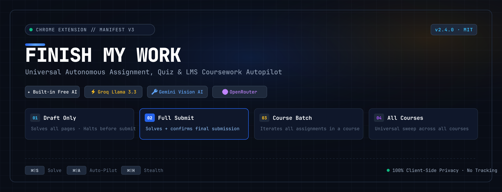
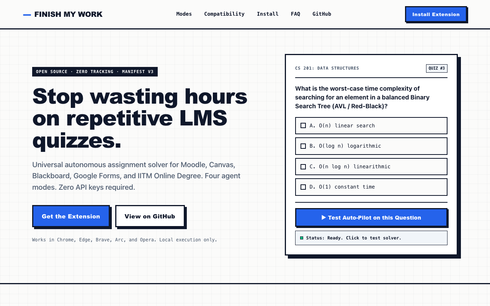
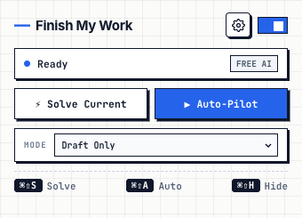
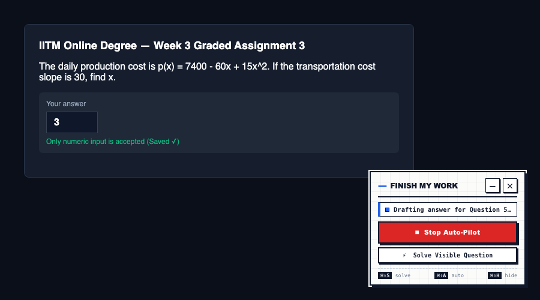
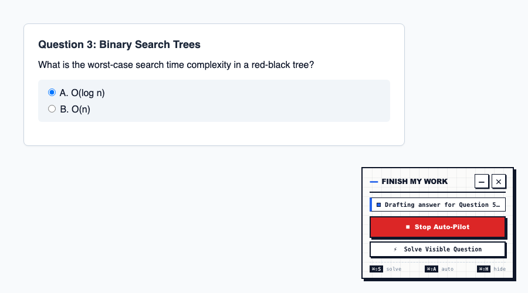

<p align="center">
  <a href="https://rushilbh27.github.io/finish-my-work/">
    
  </a>
</p>

<p align="center">
  <a href="https://rushilbh27.github.io/finish-my-work/">
    
  </a>
  &nbsp;
  <a href="https://github.com/rushilbh27/finish-my-work/stargazers">
    
  </a>
  &nbsp;
  
  &nbsp;
  
</p>

---

## ⚡ What is Finish My Work?

**Finish My Work** is an open-source Chrome extension that autonomously solves assignments, quizzes, and assessments across modern learning platforms.

🌐 **Landing Page & Live Demo:** [rushilbh27.github.io/finish-my-work](https://rushilbh27.github.io/finish-my-work/)

Whether your course runs on **Moodle**, **Canvas**, **Blackboard**, **Google Forms**, or custom Single-Page Application (SPA) quiz portals, Finish My Work detects on-screen questions, solves them using multi-engine AI (Groq, Gemini, OpenRouter), navigates between questions automatically, and submits when finished.

---

## 📸 Screenshots & Interface

<p align="center">
  
</p>

<table width="100%">
  <tr>
    <td width="35%" align="center" valign="top">
      <strong>Toolbar Popup</strong><br/><br/>
      
    </td>
    <td width="65%" align="center" valign="top">
      <strong>In-Page Floating HUD</strong><br/><br/>
      
      <br/><br/>
      
    </td>
  </tr>
</table>

- **Toolbar Popup (`popup/`)**: Quick-access settings to switch AI models, select autopilot mode, adjust delay timers, and trigger Auto-Pilot.
- **In-Page Floating HUD (`content/`)**: An on-screen widget that attaches directly to your quiz, showing real-time solver logs and controls. Press <kbd>⌘⇧H</kbd> (or <kbd>Ctrl+Shift+H</kbd>) for instant stealth mode (hide/show).
- **Interactive Web Demo (`index.html`)**: Try an interactive simulated quiz directly in your browser without installing the extension at [rushilbh27.github.io/finish-my-work](https://rushilbh27.github.io/finish-my-work/).

---

## 🚀 The 4 Autopilot Modes

| Mode | Behavior | Ideal Use Case |
| :--- | :--- | :--- |
| **01. Draft Only** | Solves questions and marks choices silently without pressing the final submit button. | When you want to double-check answers yourself before final submission. |
| **02. Full Submit** | Solves all questions, advances paginated pages, confirms submission dialogs, and lands on review. | Turning in a single quiz or homework completely autonomously. |
| **03. Course Batch** | Automatically navigates and solves all assignments and quizzes within the current course. | Clearing an entire subject's backlog in one sitting. |
| **04. All Courses** | Sweeps across all enrolled courses on your dashboard, automatically skipping practice tests and only completing **Graded** assignments. | End-of-semester autonomous completion across all subjects. |

---

## 🤖 AI Engines Supported

- ✦ **Built-in Free AI**: Zero keys or setup required. Automatically manages 30s cooldowns so questions are never dropped.
- ⚡ **Groq Cloud (Recommended)**: Sub-second reasoning via `llama-3.3-70b-versatile` with zero wait time. Free keys at [console.groq.com](https://console.groq.com/keys).
- 🔑 **Google Gemini**: Full multimodal vision support for circuit diagrams, geometry, and schematics via [Google AI Studio](https://aistudio.google.com/app/apikey).
- 🌐 **OpenRouter**: Connect DeepSeek R1, Claude, or GPT-4o via your [OpenRouter](https://openrouter.ai/keys) key.

---

## ⌨️ Keyboard Shortcuts

| Shortcut (Mac) | Shortcut (Windows/Linux) | Action |
| :--- | :--- | :--- |
| <kbd>⌘⇧S</kbd> | <kbd>Ctrl+Shift+S</kbd> | **Solve Current Question** |
| <kbd>⌘⇧A</kbd> | <kbd>Ctrl+Shift+A</kbd> | **Start / Stop Auto-Pilot** |
| <kbd>⌘⇧H</kbd> | <kbd>Ctrl+Shift+H</kbd> | **Stealth Mode** (Toggle on-screen HUD visibility) |
| <kbd>Esc</kbd> | <kbd>Esc</kbd> | **Minimize HUD** to corner tab |

---

## 🛠️ Installation in 60 Seconds

1. Clone or download this repository:
   ```bash
   git clone https://github.com/rushilbh27/finish-my-work.git
   ```
2. Open Google Chrome (or Edge, Brave, Arc, Opera).
3. Navigate to `chrome://extensions` in the address bar.
4. Enable the **"Developer mode"** toggle in the top-right corner.
5. Click **"Load unpacked"** and select the `finish-my-work` directory.
6. Open your quiz page and press <kbd>⌘⇧S</kbd> or <kbd>⌘⇧A</kbd>.

---

## 🔒 Privacy & Architecture

- **100% Client-Side**: All DOM parsing and API calls happen directly inside your browser extension context.
- **Zero Telemetry**: No third-party analytics, tracking pixels, or external trackers.
- **Encrypted Local Storage**: API keys are saved exclusively in your browser's private `chrome.storage.local`.

---

## 📄 License

Licensed under the [MIT License](LICENSE).
