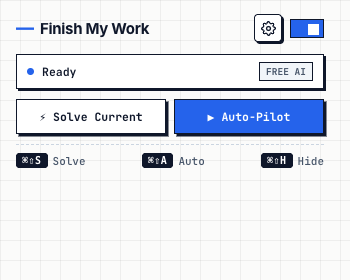
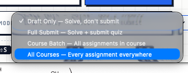

<p align="center">
  
</p>

<p align="center">
  <strong>Universal Autonomous Assignment & Quiz Autopilot for Chrome</strong>
</p>

<p align="center">
  <a href="https://github.com/rushilbh27/finish-my-work/stargazers"></a>
  <a href="LICENSE"></a>
  
  
  <a href="https://github.com/rushilbh27/finish-my-work/pulls"></a>
</p>

---

## ⚡ Overview

**Finish My Work** is an open-source, high-speed autonomous Chrome extension that automates repetitive LMS homework, Moodle quizzes, TinyMCE brief answers, and interactive H5P modules with surgical precision.

Built with a sleek neo-brutalist technical interface, multi-engine AI intelligence (**Groq**, **Gemini Vision**, **OpenRouter**, and a **Built-in Free Tier** with auto-pacing cooldowns), and **4 autonomous agent modes**, it turns hours of repetitive school portal clicks into a single shortcut press.

---

## 📸 Visual Showcase

<p align="center">
  
  &nbsp;
  
</p>

<p align="center">
  
  <br />
  <em>Agent Mode Selector: Full descriptive context in the menu, clean compact labels when selected.</em>
</p>

---

## 🚀 The 4 Autonomous Agent Modes

| Mode | Short Label | Description & Workflow |
| :--- | :--- | :--- |
| **Mode 1** | **Draft Only** | **Solve, don't submit.** Solves all questions on the page, handles multi-page pagination, but halts safely before final submission so you can review answers with complete peace of mind. |
| **Mode 2** | **Full Submit** | **Solve + submit quiz.** Solves every question, handles pagination, triggers the final submission button, bypasses Moodle double-confirmation modals, and stops once the "Response received" state is verified. |
| **Mode 3** | **Course Batch** | **All assignments in course.** Sequentially crawls through all quizzes, modules, and reading materials in your active course, solving and marking them complete. |
| **Mode 4** | **All Courses** | **Every assignment everywhere.** Full autonomous sweep across all enrolled courses on your portal dashboard. |

---

## 🧠 Multi-Engine AI Architecture

Finish My Work never leaves you stranded with a broken rate limit or expired trial:

- ✦ **Built-in Free Engine (Zero-Key)**: Works out of the box with zero API keys or configuration. Includes an automated countdown timer that paces requests through free-tier server cooldowns so no question is ever skipped.
- ⚡ **Groq Cloud (Ultra-Fast 500+ T/s)**: Connect your free Groq key (`gsk_...`) for instant Llama 3.3 70B solving with zero wait times. Get one in 10 seconds at [console.groq.com](https://console.groq.com/keys).
- 🔑 **Google Gemini (Vision AI)**: Connect your Gemini key from [Google AI Studio](https://aistudio.google.com/app/apikey). Capable of reading diagrams, circuit schematics, graphs, and chemistry formulas.
- 🌐 **OpenRouter**: Access DeepSeek R1, Claude 3.5 Sonnet, or GPT-4o with your custom [OpenRouter](https://openrouter.ai/keys) key.

---

## ✨ Key Features

- **🧩 Native H5P Module Cracker**: Reads flashcards and crossword memory directly from the client-side DOM objects and solves them in milliseconds with 100% precision.
- **📝 TinyMCE & Rich Text Automation**: Injects concise, natural academic answers directly into rich-text essay boxes and triggers native input dispatchers so forms detect content change.
- **📚 1-Click Course Completion**: Automatically scans and ticks off "Done" buttons for all PDFs, reading chapters, and video lectures.
- **⌨️ Muscle-Memory Shortcuts**:
  - <kbd>⌘⇧S</kbd> / <kbd>Ctrl+Shift+S</kbd> : Solve Current Question
  - <kbd>⌘⇧A</kbd> / <kbd>Ctrl+Shift+A</kbd> : Trigger Autonomous Auto-Pilot
  - <kbd>⌘⇧H</kbd> / <kbd>Ctrl+Shift+H</kbd> : Stealth Toggle (Show / Hide on-page HUD)
- **🔒 100% Local Privacy**: Zero telemetry, zero external tracking databases, and zero analytics. Your API keys and school sessions stay strictly inside your browser's encrypted `chrome.storage.local`.

---

## 🛠️ 30-Second Quickstart Installation

1. Clone or download this repository:
   ```bash
   git clone https://github.com/rushilbh27/finish-my-work.git
   ```
2. Open Google Chrome (or Brave, Arc, Edge, Opera).
3. Navigate to `chrome://extensions/` in your URL bar.
4. Turn on the **"Developer mode"** toggle in the top-right corner.
5. Click **"Load unpacked"** in the top-left corner.
6. Select the cloned `finish-my-work` folder.
7. Pin **Finish My Work** to your toolbar — you're ready to conquer your workload!

---

## 🎯 How to Use

1. Navigate to your LMS portal (Moodle, PESLMS, Canvas, etc.).
2. Open any quiz attempt, assignment, or study module.
3. Click the extension icon in your Chrome toolbar:
   - Pick your desired **Agent Mode** (`Draft Only`, `Full Submit`, `Course Batch`, or `All Courses`).
   - Click **▶ Auto-Pilot** (or press <kbd>⌘⇧A</kbd>).
4. Watch the extension effortlessly fill answers, navigate pages, and complete your tasks.

---

## 🧑‍💻 About the Project & Author

**Finish My Work** was designed and engineered by **[Rushil Bhor](https://github.com/rushilbh27)**.

> *"Students waste hundreds of hours every semester clicking through arbitrarily rate-limited quizzes, buggy flashcard widgets, and reading checkboxes that teach very little. Finish My Work was built to eliminate the mindless digital busywork so you can focus on building real projects, doing actual deep work, and learning what matters."*

If this tool saved your grade, spared your sanity, or gave you back your weekends, please **drop a Star (★) on GitHub** — it helps more students discover it!

---

## 🤝 Contributing

Contributions, issues, and feature requests are welcome!

1. Fork the Project
2. Create your Feature Branch (`git checkout -b feature/EpicFeature`)
3. Commit your Changes (`git commit -m 'feat: Add support for Canvas quiz format'`)
4. Push to the Branch (`git push origin feature/EpicFeature`)
5. Open a Pull Request

---

## 📄 License

Distributed under the **MIT License**. See [`LICENSE`](LICENSE) for more details.
